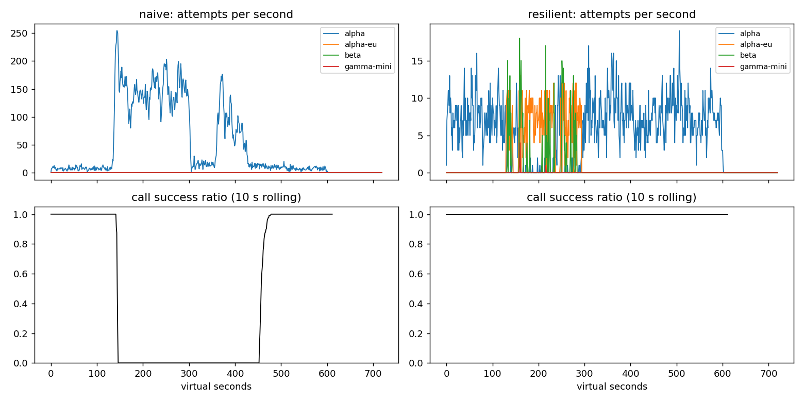

# Lab 25B — Báo cáo Game Day

**Họ tên / nhóm:** Nguyễn Vũ Quang Anh 
**MSV:** _Cần bổ sung trước khi nộp_  
**Commit:** _WORKTREE — cập nhật bằng commit nộp bài_  
**Điểm tự động (`make grade`):** **84 / 88** trên dữ liệu công khai; 4 điểm SLO còn lại do giảng viên chấm trên dữ liệu ẩn.

Môi trường chạy: Python 3.10+, seed 25. Toàn bộ 82 unit test vượt qua; 6/6 băng Game Day, workflow, SLO công khai và C1 đều PASS.

## 1. Kết quả Game Day (naive so với resilient)

| Băng | Client | availability | p95 (s) | amplification | retry_ratio | cost/turn | recovery (s) | PASS? |
|---|---|---:|---:|---:|---:|---:|---:|:---:|
| G1 | naive | 0,7194 | 7,157 | 7,738 | 6,738 | 2,163 | 4 | Không |
| G1 | resilient | 1,0000 | 4,776 | 1,062 | 0,002 | 2,101 | 0 | Có |
| G2 | naive | 0,4560 | 15,034 | 9,904 | 8,904 | 4,627 | 155 | Không |
| G2 | resilient | 1,0000 | 10,920 | 1,041 | 0,007 | 2,119 | 0 | Có |
| G3 | naive | 1,0000 | 4,768 | 1,164 | 0,164 | 2,328 | 0 | Không |
| G3 | resilient | 1,0000 | 4,660 | 1,060 | 0,034 | 2,145 | 0 | Có |
| G4 | naive | 1,0000 | 13,764 | 1,004 | 0,004 | 2,008 | 0 | Không |
| G4 | resilient | 1,0000 | 5,562 | 1,015 | 0,002 | 2,072 | 0 | Có |
| G5 | naive | 0,3699 | 5,359 | 17,030 | 16,030 | 2,124 | — | Không |
| G5 | resilient | 0,8179 | 5,477 | 1,003 | 0,002 | 2,504 | — | Có |
| G6 | naive | 0,5170 | 4,836 | 12,344 | 11,344 | 2,009 | 0 | Không |
| G6 | resilient | 1,0000 | 5,961 | 1,055 | 0,019 | 2,189 | 0 | Có |

Kết quả chi tiết nằm trong `reports/gameday/naive.json` và `reports/gameday/resilient.json`.

## 2. Cấu hình client và lý do

| Tham số | Giá trị | Lý do dựa trên số liệu |
|---|---:|---|
| `attempt_timeout_s` | 8,0 s | Đủ dài so với median 1,2–1,8 s nhưng vẫn còn thời gian failover trong deadline 30 s. Với 30 s, G6 chỉ còn availability 0,9488 và 122 lượt hết deadline/không còn provider; với 8 s đạt 1,0000. |
| `max_attempts_per_provider` | 2 | Cho phép đúng một retry cùng provider. Kết hợp budget giữ amplification trong khoảng 1,003–1,062 trên 6 băng. |
| `backoff_base_s / cap_s` | 0,25 / 4,0 s | Full jitter phân tán retry; cap 4 s vẫn đủ chỗ cho failover trước deadline. G1 có 0 vi phạm `retry-after`. |
| `retry_budget_ratio` | 0,1 | G3 giữ retry ratio 0,034. Khi vô hiệu hóa budget trong thí nghiệm, retry ratio G3 tăng lên 0,159 và trượt ngưỡng 0,10. |
| `breaker.window_size / min_calls` | 20 / 10 | Cửa sổ đủ nhanh để phát hiện G2/G4 nhưng không trip vì vài lỗi nền. G2 đạt availability 1,0 và recovery 0 s. |
| `breaker.failure_rate_threshold` | 0,5 | Trip khi đa số kết quả gần nhất hỏng; không tính 400/429 vào sức khỏe provider nên G5 có 0 failover không cần thiết. |
| `breaker.slow_call_s` | 5,0 s | Nhận diện alpha chậm trước khi timeout 8 s; G4 giảm p95 từ 13,764 s xuống 5,562 s. |
| `breaker.slow_rate_threshold` | 0,6 | Chỉ mở khi chậm là xu hướng, tránh phản ứng quá mức với đuôi latency đơn lẻ. |
| `breaker.open_duration_s` | 10,0 s | Giảm tải đủ lâu nhưng probe sớm; G2 và G6 đều có recovery 0 s, traffic về alpha đạt 100%. |
| `breaker.half_open_max_probes / successes` | 2 / 2 | Giới hạn đàn hồi đồng thời, chỉ đóng sau hai probe tốt; tránh thundering herd khi provider vừa hồi phục. |

Luồng quyết định của `on_error`:

```text
error
 ├─ 400/401/403/404/422 → release permit → GiveUp(client_error)
 ├─ 429 insufficient_quota → release → quota cooldown 300 s → provider kế
 ├─ 429 rate_limit → release → cooldown theo Retry-After → provider kế
 └─ 5xx/529/503/timeout → ghi failure vào breaker
      ├─ còn attempt + còn retry token + còn deadline → retry cùng provider với full jitter
      └─ ngược lại → provider tương thích kế tiếp → chờ cooldown ngắn ≤ 5 s → GiveUp
```

Tool call chỉ có ladder `alpha → alpha-eu → beta`; chat có thêm `gamma-mini`.

## 3. Ba thí nghiệm

1. **Retry budget là lớp phòng thủ cuối.** Mình đặt `breaker.min_calls=1.000.000.000` và `max_attempts_per_provider=5`. Khi giữ budget, G2 có amplification 1,380, retry ratio 0,058, recovery 0 s và availability 0,9987; khi tắt budget, các số thành 1,678, 0,494, 20 s và 0,9661. Trên G3, retry ratio tăng từ 0,068 lên 0,159. Breaker tốt ngăn gửi vào provider hỏng theo sức khỏe tổng thể; budget vẫn cần để chặn khuếch đại trước khi cửa sổ breaker đủ mẫu hoặc khi breaker cấu hình sai.

2. **`attempt_timeout_s=30`.** G6 giảm availability từ 1,0000 xuống 0,9488, với 109 `deadline` và 13 `no_provider_available`; p95 của các lượt sống sót lại giảm từ 5,961 xuống 5,315 s, minh họa survivorship bias. G4 gần như không đổi: availability vẫn 1,0000, p95 5,608 s so với 5,562 s, vì slow-call breaker chuyển tải trước khi timeout. Timeout nên lấy từ p99 bình thường và ngân sách deadline dành cho mỗi failover, không lấy nguyên deadline 30 s của user.

3. **Bỏ lọc tool calling.** G6 sinh 234 `incompatible_routes`, làm 234 lượt nhận output không dùng được và availability giảm từ 1,0000 xuống 0,9019. Với góc nhìn sản phẩm: model rẻ/nhanh vẫn không phải fallback hợp lệ nếu không thể tạo lệnh tool mà luồng hoàn tiền bắt buộc cần.

## 4. Workflow hoàn tiền exactly-once

| Executor | completion | crashes | duplicate refunds | duplicate emails | lost refunds | overpaid | wasted LLM / crash |
|---|---:|---:|---:|---:|---:|---:|---:|
| naive | 1,000 | 81 | 128 | 81 | 0 | 1.496.700 cent | 1,123 |
| ours | 1,000 | 66 | 0 | 0 | 0 | 0 cent | 0,303 |

Idempotency key ngăn payment/email thực thi hai lần khi response mất hoặc worker chết sau commit, nhưng không tránh việc chạy lại các bước LLM đã hoàn thành. Checkpoint giúp resume và giảm lãng phí, nhưng một mình nó không thể giải quyết cửa sổ crash giữa lúc side effect đã commit và lúc checkpoint được ghi. Vì vậy phải thực thi với khóa ổn định `(session, step)`, rồi mới checkpoint kết quả. Ghi checkpoint trước payment có thể đánh dấu “đã hoàn tiền” dù tiền chưa hề đi, tạo lost refund.

## 5. Alerting và error budget

| Sự cố | Mong đợi | Naive alerter | Burn-rate alerter | Độ trễ burn-rate |
|---|---|---|---|---:|
| `checkout_bug` | page | page | page | 27 phút |
| `provider_outage` | page | page | page | 4 phút |
| `deploy_blip` | none | page sai | không page | — |
| `slow_leak` | ticket | bỏ sót | ticket | 1.337 phút |
| `degraded_evening` | page | page | page | 291 phút |
| `night_spike` | none | page sai | không page | — |
| `small_bump` | none | page sai | không page | — |

Trong 25.901.755 request, budget cho SLO 99,5% là 129.508,8 lỗi; có 55.618 lỗi, tức đã tiêu 42,95% và còn 57,05%. Chưa cần đóng băng release. `small_bump` kéo dài 20 phút ở 12% lỗi nhưng chỉ tiêu khoảng 1% budget tháng: cả cửa sổ dài và ngắn không đồng thời vượt ngưỡng burn-rate, nên tạo page lúc 11 giờ trưa sẽ gây nhiễu hơn là bảo vệ SLO.

## 6. Postmortem — G2 với client naive (blameless)



**Tóm tắt.** Từ t=120 đến t=300, alpha mất 75% GPU; client ba tầng retry làm tải tăng nhanh thay vì shed load. Provider hồi phục ở t=300 nhưng hàng đợi và retry tự duy trì tới khoảng t=455. Resilient client loại vòng lặp đó: availability tăng 45,60% → 100%, amplification giảm 9,904 → 1,041 và recovery giảm 155 s → 0 s.

**Ảnh hưởng.** 1.285/2.362 lượt user thất bại (54,40%). Tác động kéo dài khoảng 335 s từ lúc giảm capacity đến khi recovery window đạt chuẩn. Nếu giữ tốc độ trung bình 3,937 lượt/s trong 30 ngày, monthly budget 0,5% tương đương khoảng 51.019 lượt lỗi; riêng sự cố này tiêu 2,52% budget tháng.

**Timeline** — `attempts/s` là cột `attempts_alpha`; success là tỷ lệ call thành công rolling 10 s trong CSV:

| t (s) | Sự kiện | Bằng chứng |
|---:|---|---|
| 119 | Trước sự cố | 9 attempts/s; success10 = 1,000 |
| 120 | Alpha mất 75% năng lực | 5 attempts/s; success10 = 1,000, ảnh hưởng chưa tới các call đang chạy |
| 180 | Retry storm đã hình thành | 138 attempts/s; success10 = 0,000 |
| 299 | Cuối cửa sổ giảm GPU | 136 attempts/s; success10 = 0,000 |
| 300 | Alpha hồi phục hoàn toàn | vẫn 115 attempts/s; success10 = 0,000 |
| 330 | Request cũ và deadline tiếp tục làm hệ thống thất bại | 6 attempts/s mới nhưng success10 vẫn 0,000 |
| 400 | Vòng retry lại tăng tải | 51 attempts/s; success10 = 0,000 |
| 455 | Bắt đầu đạt mốc recovery | 13 attempts/s; success10 = 0,300 |
| 456 | Phục hồi đang tăng tốc | 15 attempts/s; success10 = 0,417 |

**Trigger và root cause.** Trigger là alpha mất 75% năng lực GPU trong 180 s. Root cause hệ thống là chính sách retry ba tầng, delay cố định, không jitter/budget/breaker và chỉ dùng alpha: một logical call có thể tạo tới 36 attempts. Khi client timeout, server vẫn xử lý request; request mà user đã bỏ vẫn chiếm slot, retry mới lại nối hàng, rate limit tạo thêm retry, nên tải dâng cao hơn capacity. Sau t=300, hàng đợi cũ và retry mới vẫn giữ offered load trên năng lực đã phục hồi — một metastable feedback loop.

**Điều giúp ích / làm tệ hơn.** Capacity phục hồi ở t=300 và deadline cuối cùng làm backlog cạn dần. Ngược lại, 34.475 attempts cho 3.481 logical calls, 28.381 vi phạm `retry-after`, 2.737 timeout và 26.298 rate-limit errors kéo dài sự cố. Không có breaker/fallback nên client vừa không giảm tải alpha vừa không dùng capacity còn rỗi ở deployment khác.

**Action items:**

| # | Hành động | Loại | Owner | Cách kiểm chứng |
|---|---|---|---|---|
| 1 | Bắt buộc một tầng retry với full jitter, `Retry-After` và budget 10% | prevent | Client Platform | CI G2: amplification ≤ 1,6; G3 retry ratio ≤ 0,10; G1 có 0 vi phạm `Retry-After` |
| 2 | Triển khai sliding-window breaker có slow-call và probe HALF-OPEN giới hạn 2 | mitigate | Reliability | CI G2: recovery ≤ 30 s; G4 p95 ≤ 10 s; test concurrency HALF-OPEN |
| 3 | Dashboard/alert cho amplification, retry ratio, queue age và breaker transitions | detect | SRE | Cảnh báo trước khi amplification > 1,2 trong 5 phút; drill hàng quý phải phát hiện G2 trong 5 phút |
| 4 | Fallback theo capability và diễn tập nhiều seed/băng ẩn | mitigate | ShopAgent | 3 seed: 6/6 tape PASS; G6 `incompatible_routes=0`; primary share sau restore ≥ 0,8 |

Postmortem không quy lỗi cá nhân: thiết kế cũ thiếu guardrail và CI chưa có incident replay, nên hành vi retry nguy hiểm vẫn có thể qua release.

## 7. Một điểm yếu còn lại

G2 đã đạt availability 100% nhưng p95 vẫn 10,920 s, cao nhất trong sáu băng, và beta có giá 1,4/call. Một bước tiếp theo là adaptive concurrency limit theo queue delay, kết hợp hedging có budget chỉ cho request idempotent; mục tiêu là giảm G2 p95 dưới 8 s mà vẫn giữ amplification ≤ 1,2 và không tăng cost/turn quá 5%.

## 8. Cache (Part G)

| Client | availability | faq_availability | cache_hit_ratio | stale_served | wrong_answers | outdated_answers | cost/turn | PASS? |
|---|---:|---:|---:|---:|---:|---:|---:|:---:|
| resilient (không cache) | 0,8373 | 0,8424 | 0,000 | 0 | 0 | 0 | 1,386 | Không |
| cached | 0,9124 | 0,9645 | 0,652 | 157 | 0 | 3 | 0,915 | Có |

| Tham số `cache:` | Giá trị | Lý do dựa trên số liệu |
|---|---:|---|
| `similarity_threshold` | 0,90 | 0,80 tạo 157 câu trả lời sai (`other_question`); 0,90 đưa lỗi về 0 mà hit ratio vẫn 0,652. |
| `ttl_s` | 60 s | TTL 300 s tạo 95 câu lỗi thời, vượt ngưỡng 15; 60 s chỉ còn 3. TTL 30 s giảm còn 2 nhưng hit ratio tụt từ 0,652 xuống 0,592 và cost tăng 0,915 → 0,955. |
| `max_stale_s` | 600 s | Bao phủ outage 120 s và khoảng đệm; phục vụ 157 stale answers. Đặt 0 làm FAQ availability giảm 0,9645 → 0,8733. |
| `max_entries` | 500 | Lớn hơn working set FAQ nhưng vẫn có LRU bound, ngăn bộ nhớ tăng vô hạn. |

**Thí nghiệm ngưỡng.** Với threshold 0,80 / 0,90 / 0,97, hit ratio lần lượt là 0,666 / 0,652 / 0,581; wrong answers là 157 / 0 / 0; cost/turn là 0,965 / 0,915 / 0,964. Ở 0,80, các intent “gần nhưng khác” như refund policy–refund time, đổi size–đổi màu và ship nội thành–đi tỉnh bị nhập chung; `wrong_answers_by_reason={"other_question":157}`.

**Thí nghiệm TTL.** Với TTL 30 / 60 / 300 s, hit ratio là 0,592 / 0,652 / 0,731 và outdated answers là 2 / 3 / 95. Webhook chỉ invalidate thay đổi `policy/refund` được báo ở t=150; thay đổi phí ship t=480 là silent update nên không có tín hiệu để invalidate. TTL là giới hạn duy nhất cho khoảng thời gian có thể phục vụ dữ liệu ship cũ.

**Thí nghiệm stale-if-error.** Khi `max_stale_s=0`, `stale_served=0` và FAQ availability giảm từ 0,9645 xuống 0,8733. Với cửa sổ 600 s, cache phục vụ 157 câu stale trong lúc provider outage mà vẫn giữ `wrong_answers=0`.

Câu hỏi cá nhân không được cache ngay cả theo user vì dữ liệu đơn hàng/hoàn tiền thay đổi nhanh, có yêu cầu phân quyền và revocation riêng, và key/user scope sai có thể rò dữ liệu nhạy cảm; provider hoặc data API có xác thực phải là nguồn sự thật. Khi mọi provider sập nhưng dashboard user-facing vẫn xanh nhờ cache, on-call phải nhìn thêm `provider_attempt_success_rate`, số breaker OPEN, `stale_served`/tỷ lệ stale và tuổi cache; alert khi provider success gần 0 hoặc stale-serving tăng, không chỉ dựa vào availability cuối cùng.
